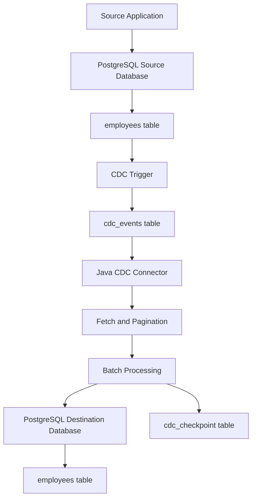

# PostgreSQL Change Data Capture (CDC) with Java

## 1. Project Overview

This project demonstrates a trigger-based Change Data Capture (CDC) implementation using PostgreSQL and Java 17.

The application captures changes made to a source PostgreSQL database and replicates them to a separate destination database using a standalone Java application.

PostgreSQL triggers capture INSERT, UPDATE, and DELETE operations. Each captured change is stored as a JSON event in a CDC event table. A Java connector continuously polls this table and applies the captured changes to the destination database.

The connector supports:

- Continuous polling
- Configurable batch processing
- Bounded fetching and pagination
- Checkpoint management
- Batch-level retry with exponential backoff
- Database connection recovery
- Transactional updates of destination records and checkpoints

**Important:** This project uses trigger-based CDC. It does not capture changes from PostgreSQL's Write-Ahead Log (WAL).

## 2. Architecture

The CDC implementation consists of two PostgreSQL databases and a standalone Java connector.

### 2.1 Source Database

The source database, `cdc_source`, contains:

- `employees`: The original employee records.
- `cdc_events`: Stores captured database changes.
- `capture_employee_changes()`: Trigger function that captures employee changes.
- `employee_changes_trigger`: Invokes the trigger function for INSERT, UPDATE, and DELETE operations.

When an employee record changes, the trigger captures the operation and the corresponding employee data as JSON and inserts an event into `cdc_events`.

The trigger executes as part of the source database transaction. Therefore, the source data modification and its CDC event insertion succeed or roll back together.

### 2.2 Java CDC Connector

The Java application, `CDCConnector.java`, connects to both databases using JDBC.

Its responsibilities include:

1. Continuously polling the source `cdc_events` table.
2. Retrieving events using configurable pagination.
3. Grouping events into configurable batches.
4. Applying INSERT, UPDATE, and DELETE operations to the destination database.
5. Updating the checkpoint after successful batch processing.
6. Retrying recognized transient transaction errors.
7. Recovering from database connection failures.

### 2.3 Destination Database

The destination database, `cdc_destination`, contains:

- `employees`: Receives replicated employee records.
- `cdc_checkpoint`: Stores the last successfully processed event ID for the connector.

The employee changes and checkpoint update are committed together in a destination database transaction. This ensures that the checkpoint advances only when the corresponding batch is successfully committed.

### 2.4 CDC Processing Flow

The overall processing sequence is:

1. An employee record is inserted, updated, or deleted in `cdc_source`.
2. The PostgreSQL trigger captures the change.
3. A corresponding event is inserted into `cdc_events`.
4. The Java connector polls the event table.
5. Events are retrieved in pages using the configured fetch size.
6. Retrieved events are divided into batches.
7. Each batch is applied to the destination database in a transaction.
8. The checkpoint is updated in the same transaction.
9. After a successful commit, the connector continues processing subsequent events.

### 2.5 Architecture Diagram



## 3. Technology Stack

| Technology | Purpose                          |
| ---------- | -------------------------------- |
| Java 17    | CDC connector implementation     |
| PostgreSQL | Source and destination databases |
| JDBC       | Database connectivity            |
| Maven      | Build and dependency management  |
| Jackson    | JSON processing                  |

## 4. Project Structure

```text
cdc-demo/
├── sql/
│   ├── 01_create_source_database.sql
│   ├── 02_create_source_tables.sql
│   ├── 03_create_cdc_function.sql
│   ├── 04_create_cdc_trigger.sql
│   ├── 05_create_destination_database.sql
│   ├── 06_create_destination_tables.sql
│   ├── 07_create_checkpoint_table.sql
│   └── cleanup.sql
│
├── src/
│   └── main/
│       └── java/
│           └── com/
│               └── clockwise/
│                   └── cdc/
│                       └── CDCConnector.java
│
├── pom.xml
├── application.properties
└── .gitignore
```

### SQL Scripts

| Script                               | Description                                                  |
| ------------------------------------ | ------------------------------------------------------------ |
| `01_create_source_database.sql`      | Creates the source database                                  |
| `02_create_source_tables.sql`        | Creates source employee and CDC event tables                 |
| `03_create_cdc_function.sql`         | Creates the CDC trigger function                             |
| `04_create_cdc_trigger.sql`          | Creates the employee change trigger                          |
| `05_create_destination_database.sql` | Creates the destination database                             |
| `06_create_destination_tables.sql`   | Creates the destination employee table                       |
| `07_create_checkpoint_table.sql`     | Creates the connector checkpoint table                       |
| `cleanup.sql`                        | Removes demo database objects while preserving the databases |

### Java Application

`CDCConnector.java` implements the CDC polling, event processing, batch transactions, checkpoint management, retry handling, and database connection recovery.

### Configuration

`application.properties` contains database connection URLs and CDC configuration settings. The database password is supplied separately through the `DB_PASSWORD` environment variable.

### Maven Configuration

`pom.xml` defines the Java project configuration and external depeButndencies.

